# Project: Predicting Product Returns

## Objective

The objective of this project is to develop a predictive machine learning model capable of identifying orders with a high probability of being returned. By flagging these high-risk orders, the company can implement strategies to reduce the financial costs associated with returns.

## Data Exploration and Feature Engineering

### Exploratory Data Analysis (EDA)

This step was performed in the Jupyter Notebook `product_return.ipynb`.

The dataset `sales_data.csv` contains 60,000 entries and 7 columns: `order_id`, `product_id`, `product_category`, `price`, `is_first_time_customer`, `order_day_of_week` and `returned`. The first column contains unique order identifiers, and the second a product identifier (200 unique products). These two columns do not carry predictive power and were excluded from the features.

* `product_category`

    Categories include: 'Engine', 'Brakes', 'Filters', 'Electronics', 'Suspension', 'Exhaust', and 'HVAC'. Most orders (20%) belong to the 'Engine' category, while 'HVAC' is the least popular (5%).

    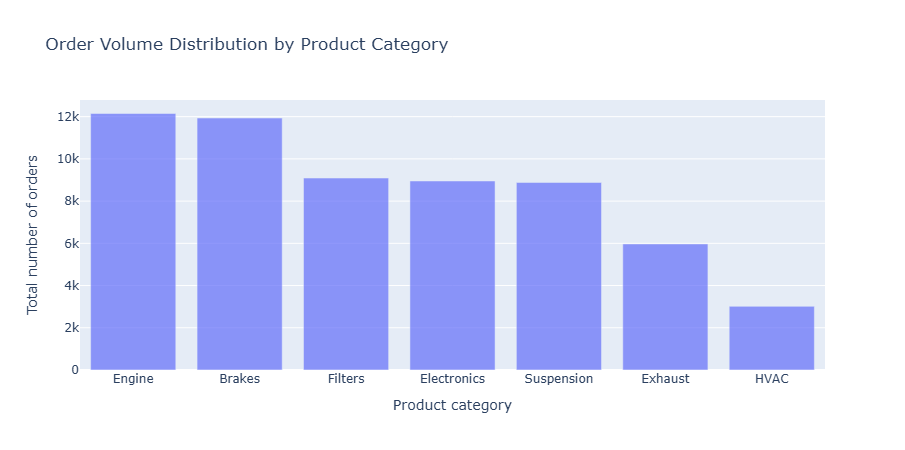

    Products in the 'Electronics' category have a much higher return rate than any other category, with an average of 0.158 compared to 0.080 for 'Engine', the second highest.

    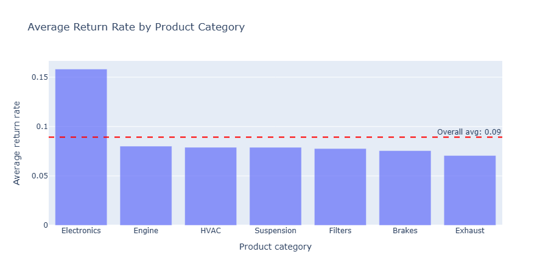

* `price`

    Product prices range from $6.47 to  $1,415.64, with a right-skewed distribution and an average of $50.51.

    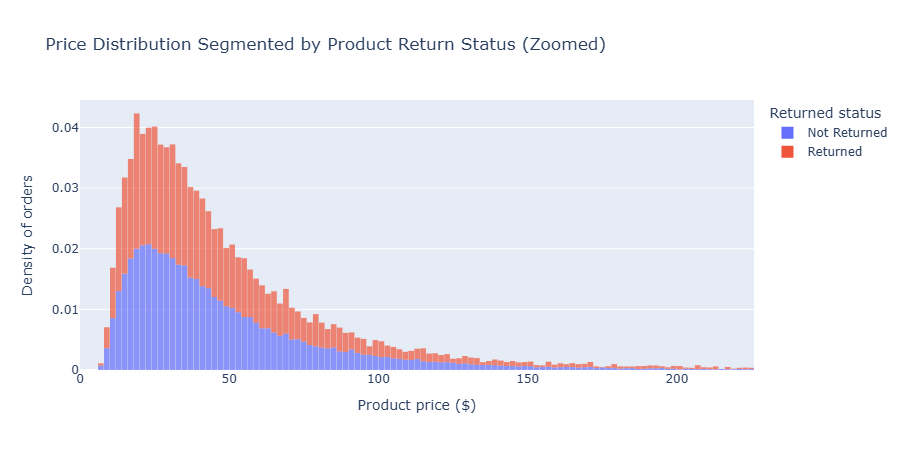

    Most prices are concentrated below $100, with a peak around $20. The distribution looks similar whether products were returned or not.

    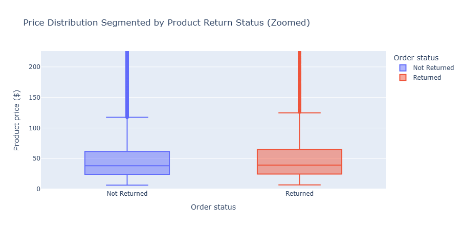

    A box plot confirms that prices do not strongly influence returns, as the median price of returned products ($39.26) is only slightly higher than that of non-returned items ($38.24).
    
* `is_first_time_customer`

    Binary variable: 1 for new customers, 0 for repeat customers. Most orders (70%) come from repeat customers.

    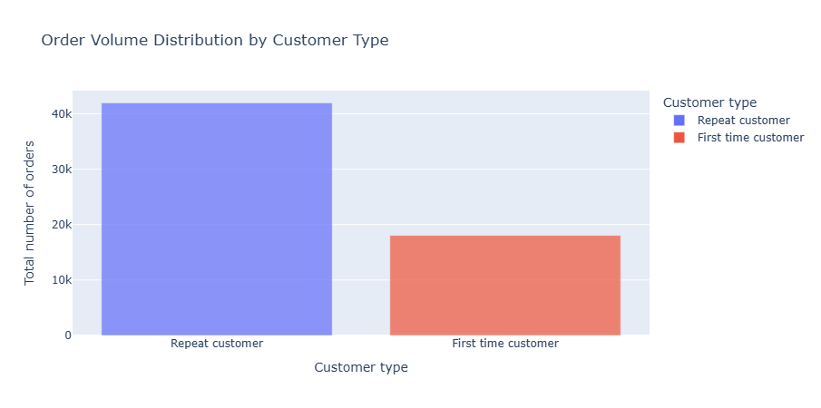

    However, the return rate of first-time customers is 1.36 times higher than that of repeat customers.

    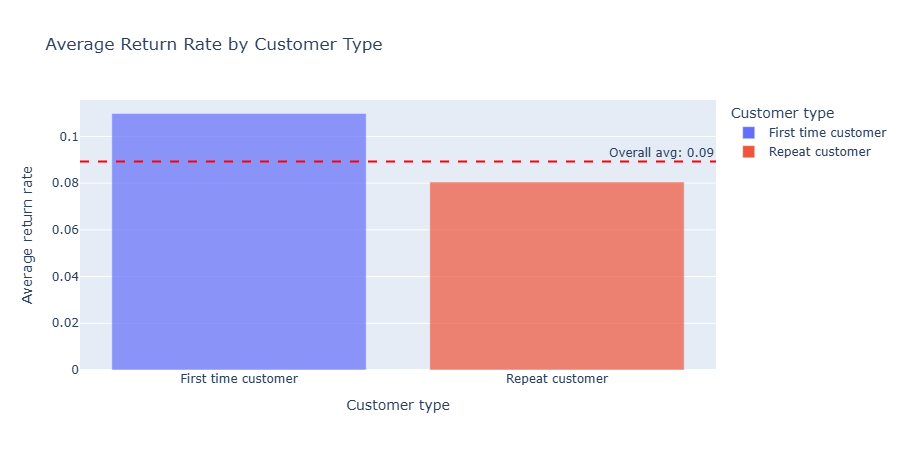
    
* `order_day_of_week`

    Integers 0-6, assumed mapping: 0 = Monday, 6 = Sunday. Most orders (14.51%) occur on day 4, while day 0 has the fewest (13.99%). The distribution is balanced across the week.

    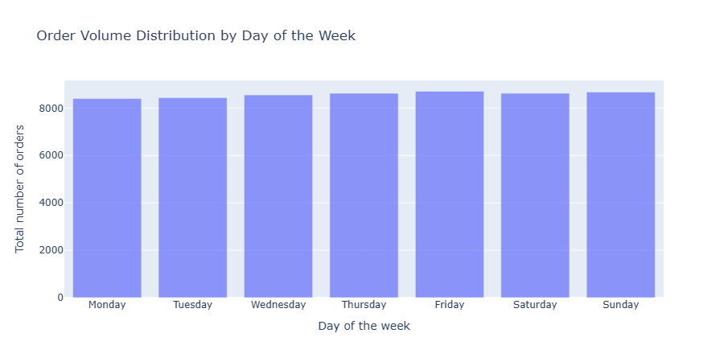

    Return rates are slightly higher on weekends (days 5 and 6).
    
    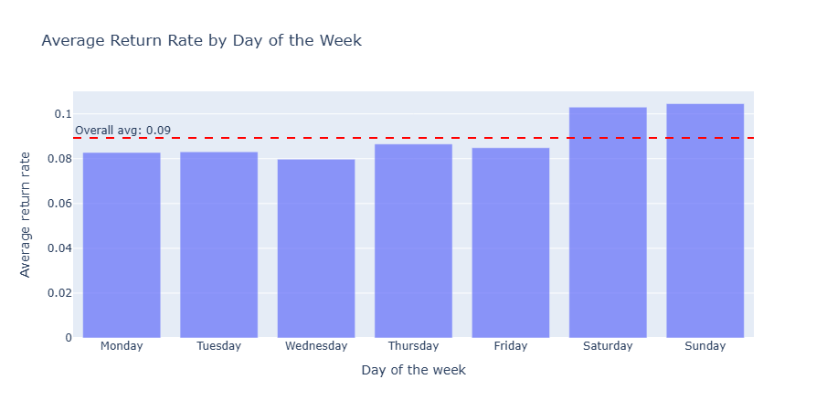

* `returned`

    The target variable, with 1 for returned and 0 otherwise. Only 8.93% of products were returned.

    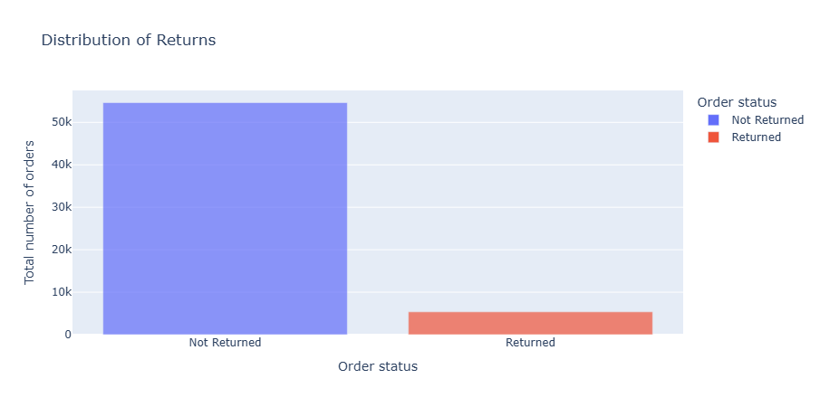

    This large class imbalance makes the prediction task challenging.

A correlation analysis shows weak but consistent signals: `is_first_time_customer` correlates 0.047 with `returned`, `price` 0.032, and `order_day_of_week` 0.028.

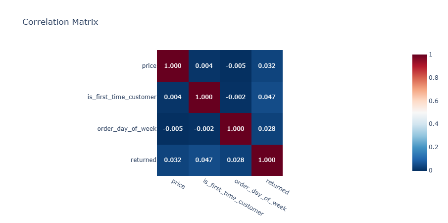

### Feature Engineering

Based on the EDA, five new features were created:

* **`is_weekend` (binary):** Flag for weekend orders (days 5-6).

* **`is_electronic` (binary):** Flag for products in the 'Electronics' category.

* **`is_very_high_price` (binary):** Flag for prices above $100.

* **`category_return_rate` (numerical):** Historical return rate by category, computed on the training set to avoid leakage.

* **`price_zscore_category` (numerical):** Price Z-score within each category, computed on the training set to avoid leakage.

Before feature engineering, the dataset was split into training (80%), validation (10%), and test (10%) sets using `train_test_split()` with `stratify` to preserve class proportions.

### EDA with Engineered Features

After feature engineering, we checked whether the new features were indicative of returns:

* **Correlation**

    The plot below shows correlations between engineered features and `returned`.

    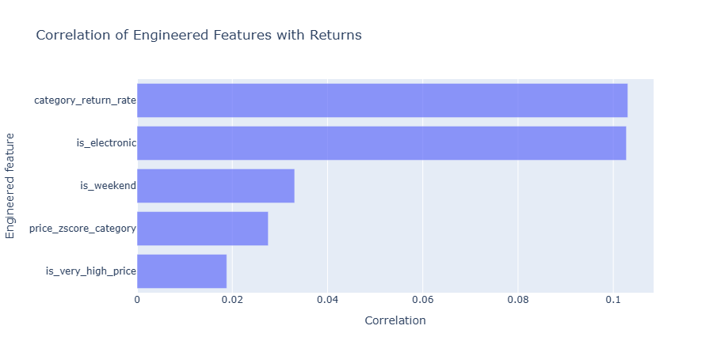

    This confirms the importance of the category return rate and electronics when predicting returns.

* **Return Rates**

    The plot below shows the average return rate by price category. The categories were defined as follows:

    * Low: $0-25
    * Medium: $25-50
    * High: $50-100
    * Very high: $100+

    The overall average return rate is shown in red.

    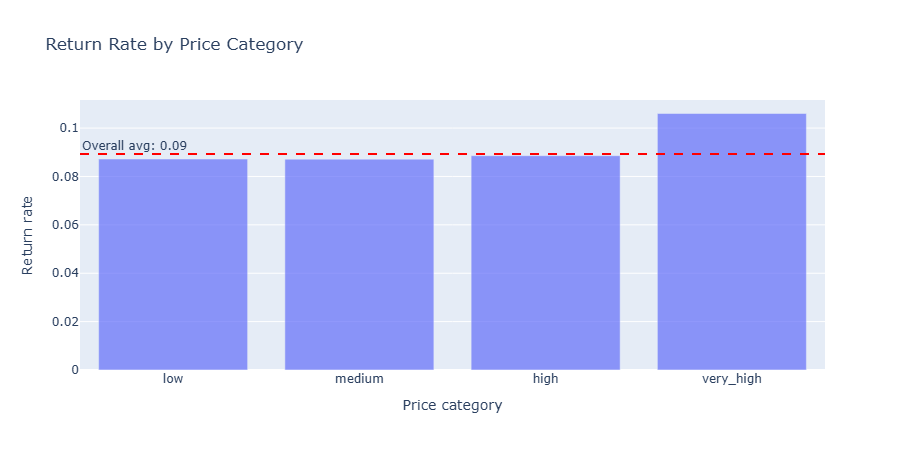

    Very high-priced products are the only group with return rates above the average.

    Returns are also slightly higher on weekends:
    
    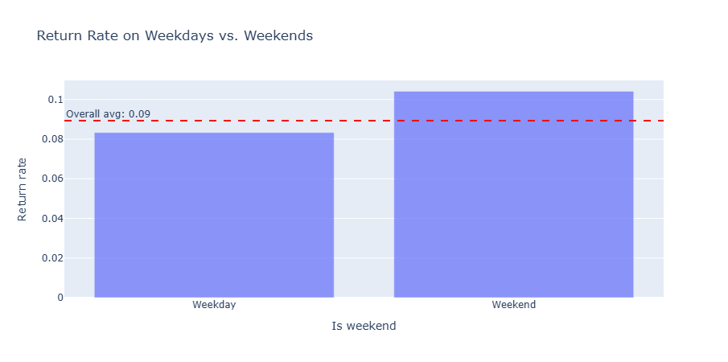

* **Price Z-Score Distribution**

    The distribution of price Z-scores, segmented by return status, is very similar across returned and non-returned products.

    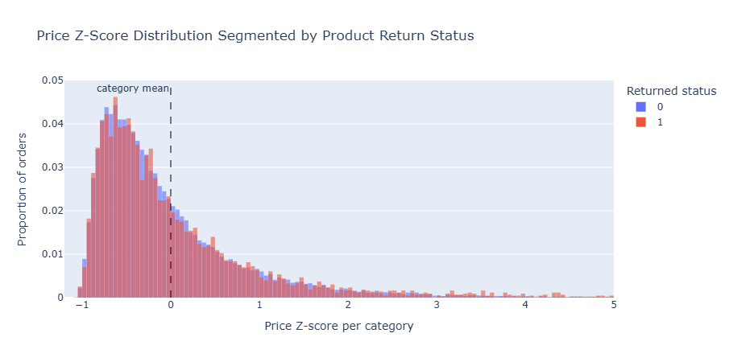


## Model Training and Evaluation

After feature engineering, we prepared the dataset for model training. Features were separated into three categories:

* **Categorical:** `product_category`, `order_day_of_week`
* **Numerical:** `price`, `category_return_rate`, `price_zscore_category`
* **Binary:** `is_first_time_customer`, `is_weekend`, `is_electronic`, `is_very_high_price`

A `ColumnTransformer` scaled numerical features with `StandardScaler`, one-hot encoded categorical features, and passed through binary features.

We tested three models, chosen for their complementary strengths:

* **Logistic Regression**
    * Baseline linear model, highly interpretable.
    * Provides calibrated probabilities, which are useful for imbalanced classification.
    * Serves as a benchmark to test whether non-linear models add value.

* **Random Forest Classifier**
    * Ensemble of decision trees, captures non-linear relationships and feature interactions.
    * Robust to outliers and irrelevant features.
    * Provides feature importance scores, aiding interpretation.
* **XGBoost Classifier**
    * Gradient-boosted trees, often among the best performers in tabular data tasks.
    * Designed to handle class imbalance through parameters like `scale_pos_weight`.
    * More complex and sensitive to hyperparameters, but powerful when tuned correctly.

On preliminary evaluation, Logistic Regression achieved the best ROC-AUC score (0.610), followed closely by Random Forest (0.609). XGBoost underperformed slightly (0.580), likely due to requiring more extensive tuning. Random Forest was chosen as the base model for further work because feature importances and decision paths can be extracted, making it easier to interpret results; it captures interactions (e.g., between price, category, and customer type) that Logistic Regression cannot; unlike XGBoost, it performs reasonably well even with minimal hyperparameter tuning; and with hyperparameter tuning, its performance can match or exceed Logistic Regression while retaining interpretability.

Hyperparameter tuning with `RandomizedSearchCV` gave the best parameters:

* `'n_estimators': 800`
* `'min_samples_split': 2`
* `'min_samples_leaf': 5`
* `'max_features': 'log2'`
* `'max_depth': 4`

### Evaluation Metrics

Because only 8.93% of products are returned, the dataset is highly imbalanced. This makes accuracy a misleading metric, since a trivial model that predicts "not returned" for every order would achieve ~91% accuracy, but would have zero business value since it never identifies actual returns.

For this reason, we focused on metrics that better capture performance on the minority (positive) class — returned products:

* **Precision:** Measures how many products were actually returned out of all the products predicted as returns. Important because flagging too many false positives wastes resources (e.g., unnecessary reviews of orders that would not be returned).

* **Recall:** Measures how many returned products were correctly identified out of all the products that were actually returned. Critical from a business perspective because missed returns (false negatives) mean lost opportunity to intervene.

* **F1-Score:** Harmonic mean of precision and recall. This metric ensures the model doesn’t maximize recall by labeling everything as “return” (low precision), or maximize precision by being overly conservative (low recall).

* **ROC-AUC:** Measures the model’s ability to distinguish between classes across thresholds. It is a useful metric to evaluate ranking performance, but can be overly optimistic under class imbalance.

* **PR-AUC (Precision-Recall AUC):** Area under the precision-recall curve. A more informative metric than ROC-AUC for imbalanced problems, because it focuses directly on the minority class.

Since the company is more interested in identifying high-risk orders (returns), PR-AUC is the most relevant metric. ROC-AUC and F1-score were also reported as secondary metrics to provide a fuller picture, as well as the confusion matrix.

* **Validation set results:**
    * ROC-AUC: 0.6119
    * PR-AUC: 0.1362
    * F1: 0.2147
    * Precision: 0.1492
    * Recall: 0.3825
    * Confusion Matrix:

        |               | Predicted: Not Returned | Predicted: Returned |
        | :------------ | :----------------: | :----------------: |
        | **Actual: Not Returned** | 4295 | 1169 |
        | **Actual: Returned** | 331 | 205 |


* **Test set results:**
    * ROC-AUC Score: 0.6096
    * PR-AUC Score: 0.1323
    * F1-Score: 0.2113
    * Precision: 0.1452
    * Recall: 0.3881
    * Confusion Matrix:

        |               | Predicted: Not Returned | Predicted: Returned |
        | :------------ | :----------------: | :----------------: |
        | **Actual: Not Returned** | 4239 | 1225 |
        | **Actual: Returned** | 328 | 208 |


## Interpretation and Reporting

Random Forest provides a built-in `.feature_importances_`, which we used to generate the feature importance plot below.

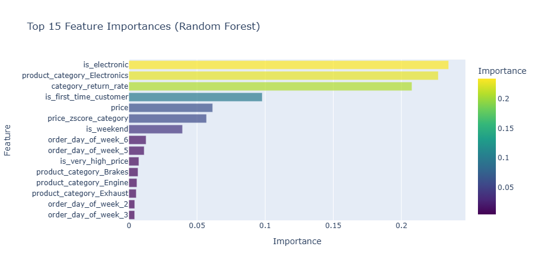

The top 15 features are shown, from `is_electronic` to `order_day_of_week3`. This confirms the value of feature engineering: features such as `is_electronic` and `category_return_rate` appear among the most important predictors.

We also used SHAP values to obtain a more granular view of feature contributions. While the order of importance differs slightly, SHAP provides consistent confirmation of key drivers:

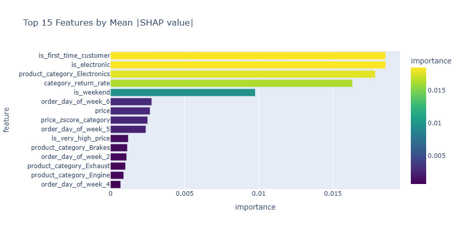

The SHAP summary plot shows individual feature effects on predictions:

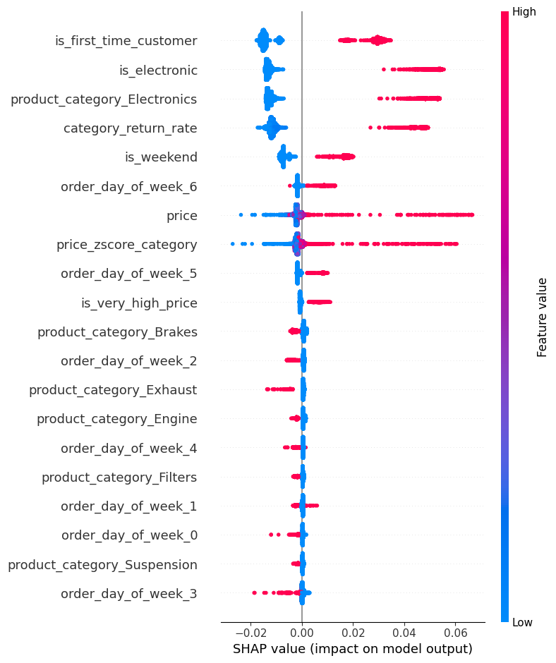

* First-time customers (`is_first_time_customer = 1`) are more likely to return products.

* Electronics (`is_electronic = 1`) stand out as the category with the highest return risk.

* Weekend orders (`is_weekend = 1`) also contribute positively to return probability.

* Price has a weaker but noticeable influence, with higher prices linked to higher returns.

Overall, the model highlights meaningful business signals: customer type, product category, and timing of orders all play a role in return behavior.

## Conclusion and Recommendations

The model’s performance remains modest (ROC-AUC ≈ 0.61, PR-AUC ≈ 0.13). For reliable deployment, stronger predictive power would be required (e.g., ROC-AUC ≥ 0.70). Additional features — such as customer demographics, product condition, or shipping details — would likely be needed to achieve this.

That said, the insights extracted are actionable:

* Electronics have the highest return rates and should be prioritized for listing reviews and quality checks.

* First-time customers are significantly more prone to returns; targeted communication (e.g., clearer product information, return policy reminders) could reduce risk.

* Weekend orders show elevated return rates, which may suggest customer behavior differences that could be addressed (e.g., through promotions or clearer product descriptions at peak times).

**Recommendation:** Focus operational attention on first-time customers buying Electronics during weekends, as this segment consistently shows higher return risk.


## Execution Instructions

Open the Jupyter notebook and run all cells:
```bash
    jupyter notebook notebooks/product_return.ipynb
```